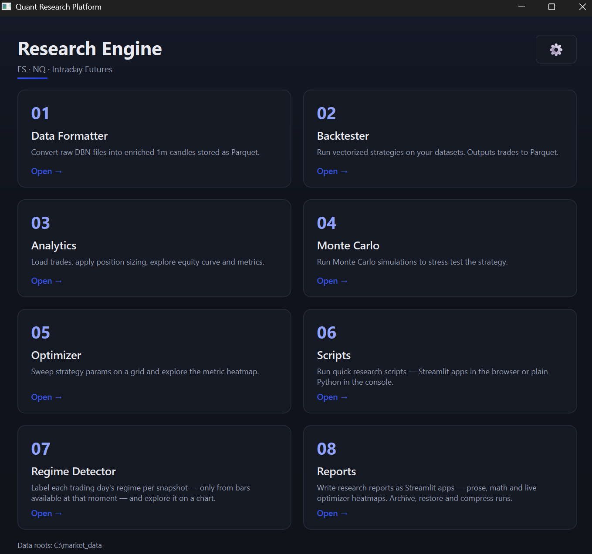
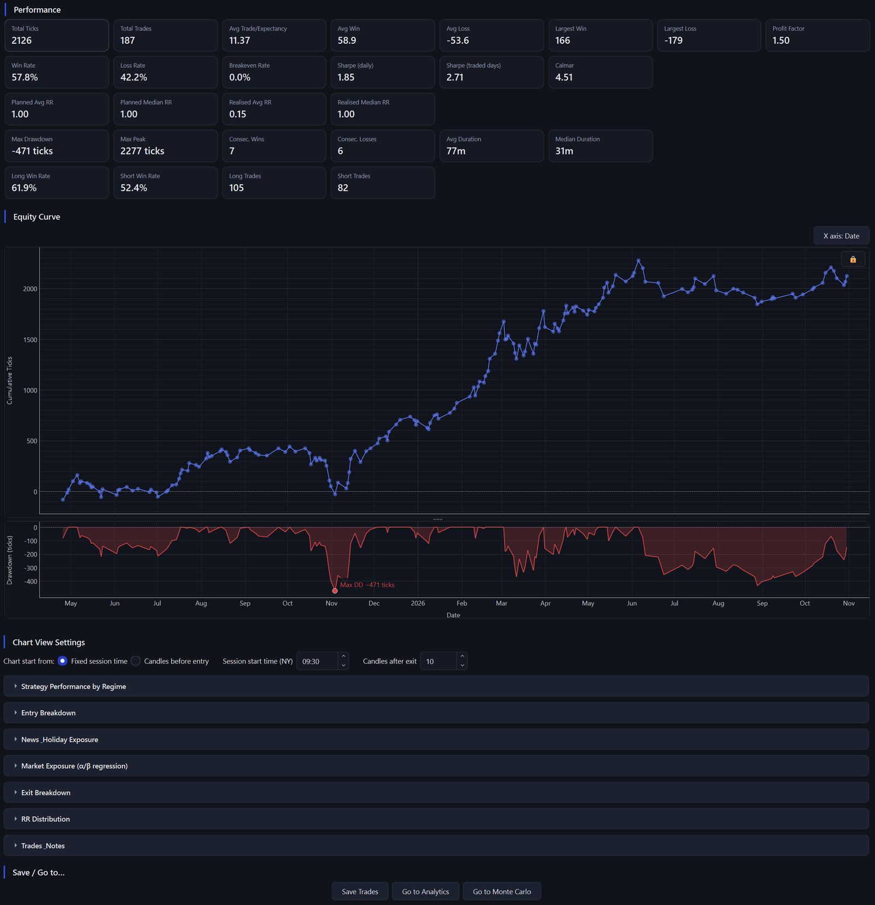
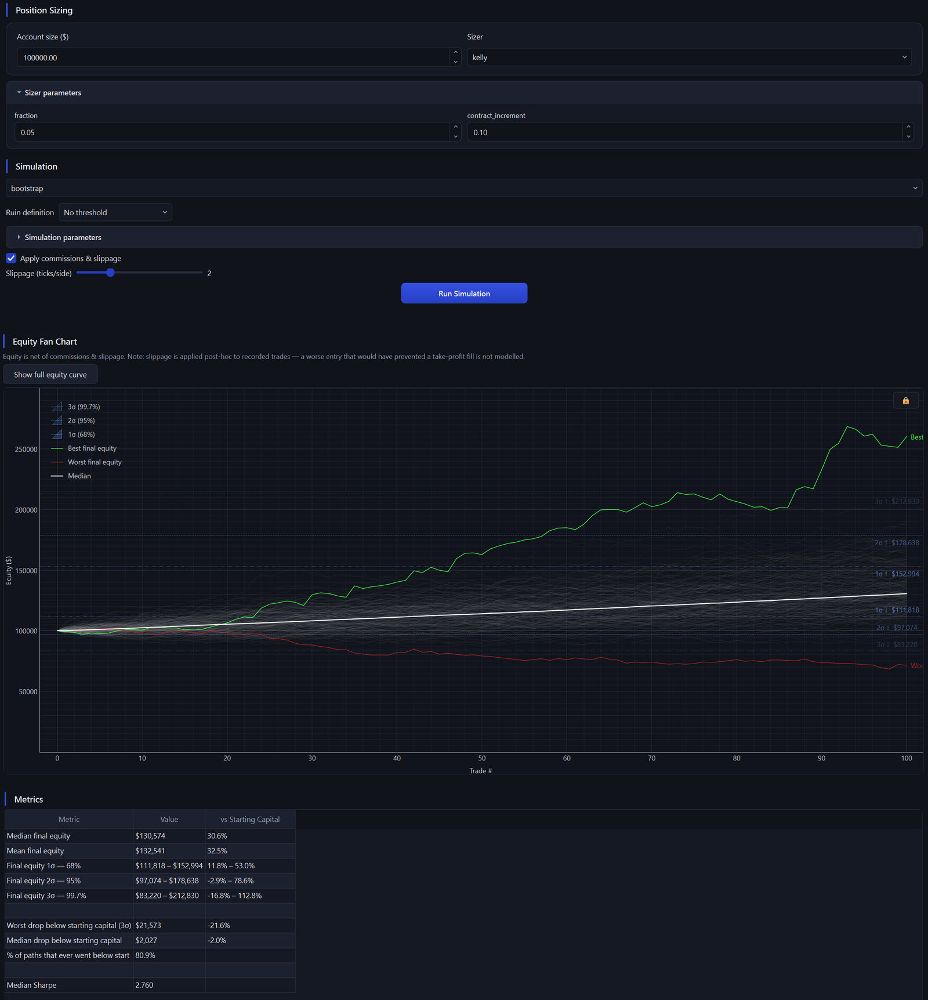
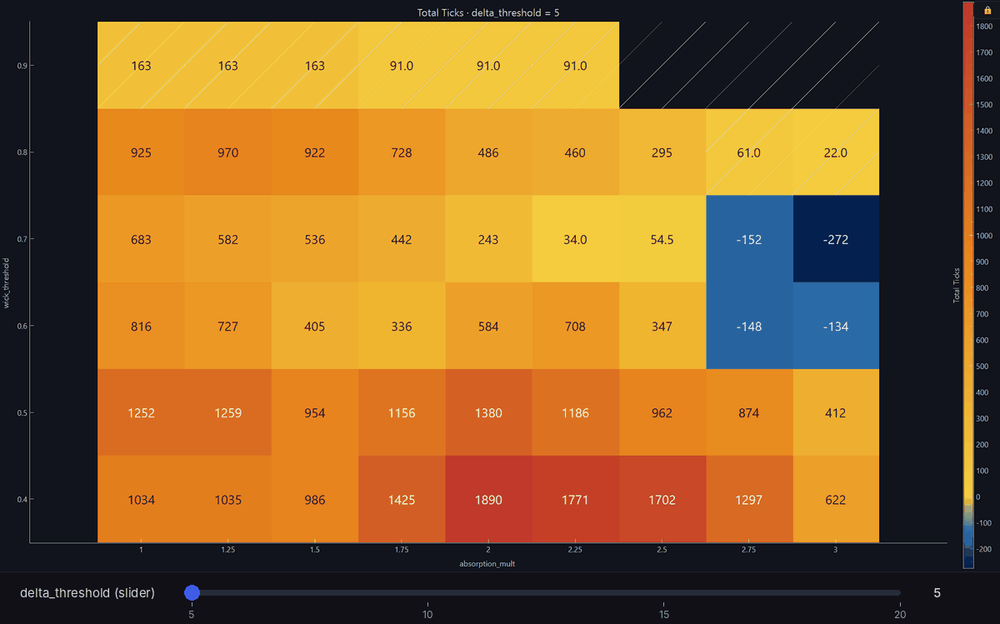
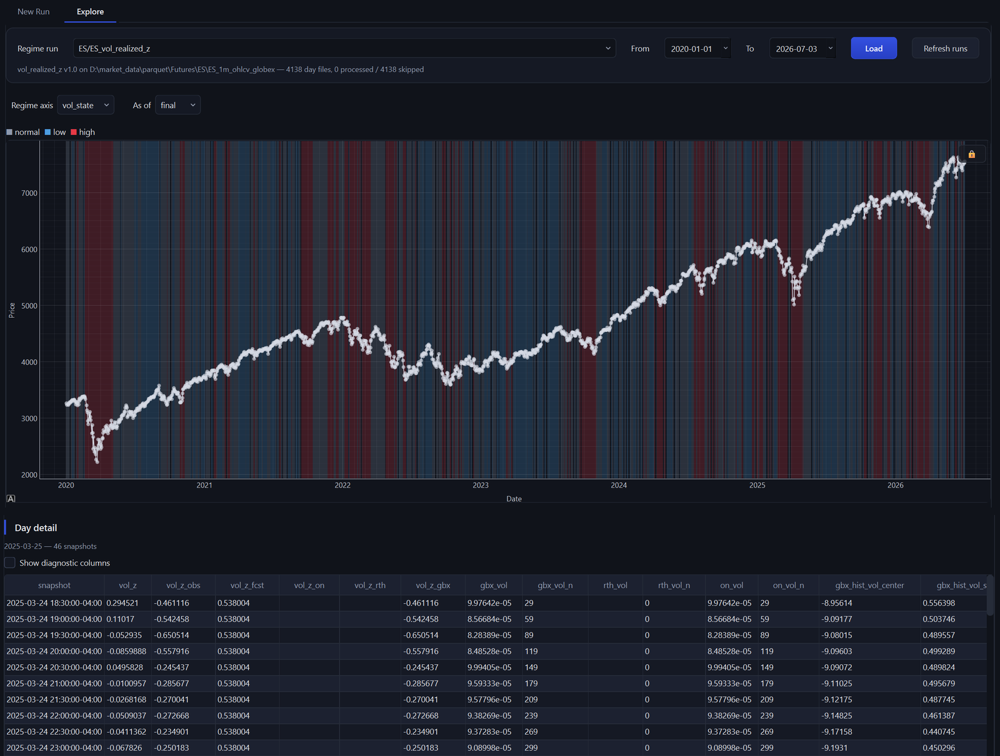

# Quant Research Platform

A modular, plugin-based desktop platform for researching intraday strategies on **30+ CME futures and options on futures**. It takes raw Databento market data (trades with best bid/offer, full L3 order book, OHLCV, options) all the way to backtests, Monte Carlo stress tests and parallel parameter optimization.

Built in Python (PySide6, NumPy, pandas, pyarrow), with a C++ (pybind11) kernel for L3 order-book replay.

<!-- SCREENSHOT: main menu / card launcher (all modules visible) -->


---

## Workflow

```
raw Databento data ──► Data Formatter ──► per-day Parquet datasets
                                              │
                    ┌─────────────────────────┼──────────────────────────┐
                    ▼                         ▼                          ▼
               Backtester                 Optimizer                Regime Detector
                    │                (parallel grid search)              │
                    ▼                         │                          │
             trades/*.parquet ◄───────────────┘      regime labels ──────┘
                    │
          ┌─────────┴─────────┐
          ▼                   ▼
   Analytics (sizing)    Monte Carlo
```

Stages exchange **Parquet files on disk**, so every module can be used on its own and the contract between stages is a column schema, not Python imports.

---

## Modules

### Data processing
Turns raw Databento files into one clean Parquet file per trading day.

- **Order-flow bars:** 1-minute OHLCV with aggressor buy/sell volume, delta, volume traded at each price and passive (resting) liquidity with order counts per price
- **Order-book snapshots:** per-second L3 book state rebuilt from every MBO event (add, cancel, modify, fill) by a C++/pybind11 kernel
- **Options:** 5-minute candles per contract and end-of-day chains with open interest and settlement prices
- **Session handling:** each ~23-hour Globex session is stitched from two day files, the front-month contract is picked by volume and roll days are flagged
- **Indicators:** session and regular-hours VWAPs with ±1/2/3σ bands, cumulative delta

### Backtesting engine
Strategies only declare the columns they need and write a `process_day` function. The engine owns everything else: the day loop, column-selective reads, lookback to previous days, caching, timing and a standard 12-column trade output.

- **LRU RAM cache** with a byte budget plus **background prefetching**: a 307-day ES backtest runs in **0.6 s from memory vs 4.5 s from disk**
- Direct pyarrow reads (about 2× faster than `pd.read_parquet`, same result)
- Per-day precomputation (`prepare_day`) cached and reused across parameter sets
- **Trade report:** performance statistics, equity and drawdown, α/β regression against a benchmark, regime and news-day exposure, and a filter chain

<!-- SCREENSHOT: Backtester trade report (stats + equity/drawdown) -->


### Position sizing
Pluggable sizers (fixed, Kelly, risk-based) applied to any backtest's trades, with commissions per asset.

### Monte Carlo
Vectorized simulations across thousands of equity paths:

- **Bootstrap** resampling of trades
- **Markov regime-switching:** transition matrix estimated from all trading days, trade outcomes drawn per regime, and days without trades still advance the chain
- **Path-dependent position sizing:** the sizer is re-applied along every simulated path, with commissions feeding back into the size
- Output: fan chart with confidence bands, probability of ruin, drawdown tails, median Sharpe

<!-- SCREENSHOT: Monte Carlo fan chart + statistics table -->


### Parallel optimizer
Grid search over up to 4 parameters (number ranges, value lists, booleans, dropdowns, bit-flag groups).

- **Date-split parallelism:** the date range is cut into contiguous chunks, one per worker process, and every worker runs every combination on its chunk. Each day is read and prepared exactly once, and the joined result is identical to a serial run
- **Explore:** heatmaps of any metric (Sharpe, profit factor, ticks per trade, total ticks, win rate, trade count) with any two parameters on the axes and the rest as sliders; train/test split at the median trade day
- **Drill-down:** clicking a cell opens the full trade report for that parameter combination
- **Combine:** merge entry variants from saved runs without re-running backtests

<!-- SCREENSHOT or GIF: optimizer heatmap, ideally moving the sliders -->


### Regime detector
Pluggable detectors (e.g. realized-volatility z-score, multi-factor mean reversion) that label each intraday snapshot with a market regime. Backtests join these labels **as-of each trade's entry time**, never by date, so no trade can see how its day ended.

<!-- SCREENSHOT: regime detector chart -->


### Reports and scripts
- **Reports:** Streamlit research write-ups with live optimizer heatmaps, launched from the app
- **Scripts:** a launcher for one-off research scripts with their own console output

---

## Plugin architecture

Every module discovers its plugins at runtime: **drop a file into the folder and it appears in the UI**, with its parameter form generated from a `PARAMS` dict. No registration.

| Folder | Plugin type | Included |
|---|---|---|
| `data_transforms/` | raw data → Parquet datasets | 10 transforms (order-flow bars, L3 book snapshots, options, big trades, …) |
| `strategies/` | trading strategies (`DATA` + `process_day`) | 6 strategies |
| `position_sizing/` | sizers (`apply(trades, params)`) | fixed, Kelly, risk-based |
| `modules/monte_carlo/methods/` | simulation methods | bootstrap, regime-switching, drawdown-rule simulation |
| `regime_detectors/` | regime labelers | 2 detectors + scaffold |
| `reports/`, `scripts/` | research reports and one-off scripts | examples |

The full strategy-author reference is in [`STRATEGY_GUIDE.md`](docs/strategy/STRATEGY_GUIDE.md).

---

## Engineering notes

- **Backend never imports Qt.** All computation lives in `backend/` packages that worker processes and tests can import safely; a test enforces this.
- **Look-ahead safety:** regime and news labels are joined as-of entry time; timestamp-unit mismatches (ns vs µs) and session boundaries are handled in one shared join.
- **Tests:** pytest suite covering the optimizer, metrics, the shared trade report, plugin loading and Qt smoke tests.
- **Generated documentation:** the platform and strategy guides are built from Markdown sources; a test fails if the committed strategy guide is out of date.

---

## Getting started

```bash
python -m venv venv
venv\Scripts\activate          # Windows
pip install -r requirements.txt
pip install ./orderbook_replay_cpp   # C++ L3 replay kernel (needs a C++ compiler, e.g. MSVC from Visual Studio 2022)
python main.py
```

Data lives outside the repo in a data root (default `D:/market_data`), configurable in Settings:

```
<root>/raw_dbn/{type}/{ASSET}/{dataset}/     raw *.dbn.zst files
<root>/parquet/{type}/{asset}/{dataset}/     one YYYY-MM-DD.parquet per day
<root>/trades/                               backtest outputs
<root>/optimizations/{run}/                  optimizer runs
<root>/regimes/{ASSET}/{run}/                regime labels
```

Market data comes from [Databento](https://databento.com/) and is not included in this repository.

---

## Documentation

- [`Quant_app_documentation.pdf`](docs/app_documentation/Quant_app_documentation.pdf): module contracts, data schemas, engine internals and measured performance
- [`STRATEGY_GUIDE.md`](docs/strategy/STRATEGY_GUIDE.md) / [`Strategy_Guide.pdf`](docs/strategy/Strategy_Guide.pdf): how to write a strategy plugin
- [`IVB_Model_Optimized_Documentation.pdf`](docs/strategy/IVB_Model_Optimized_Documentation.pdf): the flagship order-flow strategy and its vectorized rewrite

---

*Personal research project by [Jakub Borto](https://github.com/Jakub-Borto), CS&E student at TU Delft. Nothing here is investment advice.*
